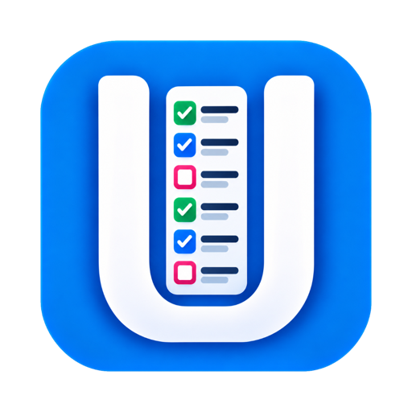
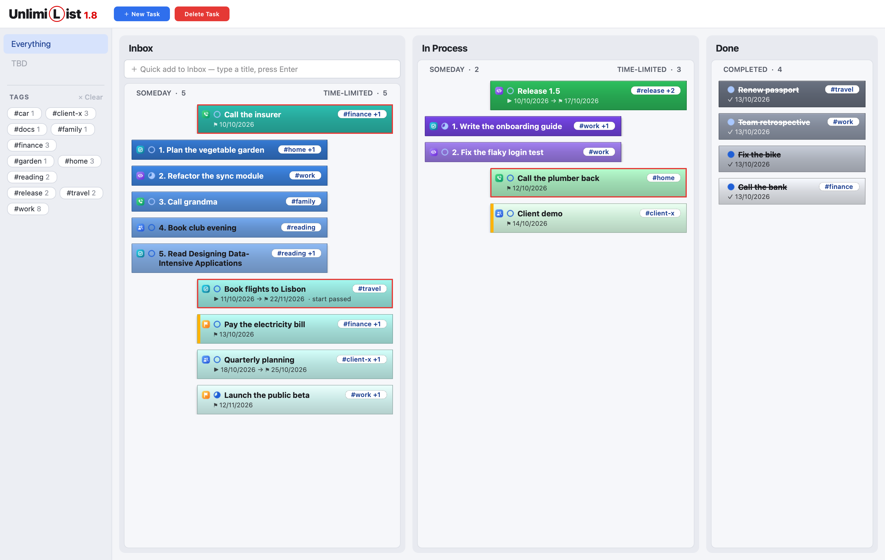
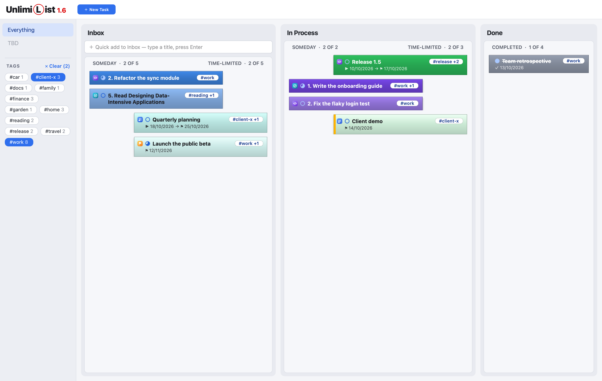
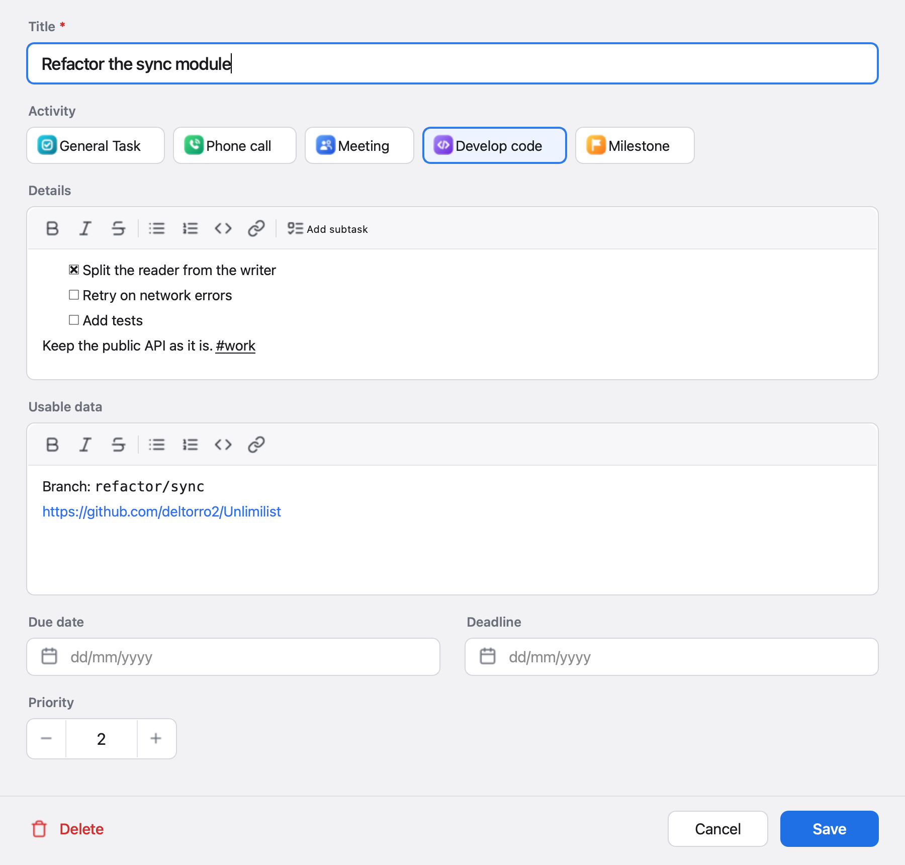

<p align="center">
  
</p>

<h1 align="center">UnlimiList</h1>

<p align="center">
  <b>The calm Kanban for people with too many Tasks.</b><br>
  Every project, every deadline and every "someday" on one Board, and your notes beside it, on your Mac, offline.
</p>

<p align="center">
  <a href="https://github.com/deltorro2/Unlimilist/releases/latest"></a>
  
  
</p>




## Why UnlimiList?

You juggle many activities, and each one throws off Tasks. Some have hard deadlines; most don't. You work on several at once, priorities shift every day, and every Task gathers its own phone numbers, links and snippets.

Jira, Todoist and TickTick do a thousand things you'll never use. Trello does too little. **UnlimiList does the few things that matter, and does them well:** a clear Board, an honest order of what's next, and everything you need for a Task right inside it. No account, no cloud, no internet required.

## What you get

- 🔒 **Your data stays yours.** Every Task and Note is a plain Markdown file on your Mac that you can read, back up or edit in any editor.
- 🗂 **One Board, three Stages.** Inbox, In Process and Done. Drag a Task along as the work moves.
- 📌 **Someday and deadline work, side by side.** Open-ended Tasks are ranked by your Priority on the left; dated Tasks are ordered by date on the right.
- 🧭 **An order that thinks ahead.** The most urgent dated Task sits on top; later ones drift down among your Someday Tasks, a step for each month away, so nothing far off crowds today.
- 🚨 **Never miss a date.** Late Tasks get a red border, and Tasks due today or tomorrow an amber stripe.
- 🧾 **Context lives with the Task.** Rich-text Details for what the Task is, and Usable data for links, numbers and code snippets.
- ✅ **Subtasks that mean it.** Checklists in the Details; a Task can't reach Done while any are open.
- 🏷 **Tags with instant filtering.** Write `#client-x` anywhere in the Details, or add it to a Note; pick Tags in the sidebar to see just those Tasks and Notes. Autocomplete suggests the Tags you already use.
- 📞 **Activities at a glance.** A badge on each card tells a call from a meeting, a question to ask, a coding session or a milestone.
- 🧹 **Tidy up fast.** Select several Tasks and delete them in one go, or duplicate a Task to reuse it. Deleted files are kept, so nothing is lost by mistake.
- 🗄 **Fold Done away.** A switch under Done folds it to a slim strip, so Inbox and In Process get the room; you can still drop Tasks on it to finish them.
- 📓 **A Notebook beside the Board.** Keep reference notes in Markdown: a sortable table of every Note, a raw-Markdown editor with colouring, and a clean rendered view. Quick-add a note in one line, or import Markdown, text, CSV, Word and PDF files, as new Notes or into the Note you're writing.
- 🔍 **Find any Note.** Search Titles and texts from the bar beside Quick note (⌘F); exact matches come first, then Notes holding some of the words. Inside a Note, ⌘F finds each place in turn.
- 🔐 **Secured Notes.** Encrypt a Note's text with one Notebook password, kept in your Mac's Keychain.
- 🔠 **Text at a size that suits you.** Pick one of five card font sizes in Settings (the gear, or ⌘,); the Board follows as you slide.

### Tags: focus on one client, one project, one theme



### Everything about a Task in one place

<p align="center">
  
</p>

## Get started

1. Download **Unlimilist-&lt;version&gt;.dmg** from the [latest release](https://github.com/deltorro2/Unlimilist/releases/latest).
2. Open it and drag **Unlimilist** onto **Applications**.
3. The first time, right-click the app in Applications and choose **Open**, then **Open** again. The app isn't notarized by Apple yet, so macOS asks once.

UnlimiList runs on macOS on Apple Silicon. Windows support is available on demand.

---

# For developers

UnlimiList is a Python 3.13 desktop app built with [PySide6](https://doc.qt.io/qtforpython-6/) (Qt 6). Tasks and Notes are stored as Markdown files with YAML front matter.

| | |
|---|---|
| Runtime | Python 3.13, PySide6 (Qt 6), PyYAML, cryptography, keyring, mammoth, pypdf |
| Tests | pytest, pytest-qt, python-docx |
| Packaging | PyInstaller (`.app`), dmgbuild (`.dmg`) |
| Environment | [uv](https://docs.astral.sh/uv/) |

## Set up

You only need [uv](https://docs.astral.sh/uv/) and Git. uv installs the pinned Python (see `.python-version`) and every dependency into a local `.venv`, so no separate Python install is needed.

```sh
brew install uv                      # or: curl -LsSf https://astral.sh/uv/install.sh | sh
git clone https://github.com/deltorro2/Unlimilist.git
cd Unlimilist
uv sync                              # Python 3.13 + runtime and dev dependencies into .venv
```

## Run and test

```sh
uv run python -m unlimilist          # run from source: uses the test folders, never your real Tasks and Notes
uv run pytest                        # all tests: the Board domain plus pytest-qt UI tests
```

The UI tests run on Qt's offscreen platform, so no windows open. Pass `QT_QPA_PLATFORM=cocoa` to run them against real macOS rendering.

## Project layout

```text
src/unlimilist/
  domain.py        Task, Stage, Activity, Tags, Subtasks: plain data and rules
  board.py         the Board: every rule for where a Task sits; no Qt
  store.py         one Markdown file per Task (load, save, delete)
  notebook.py      the Notebook: Notes, Titles, Daily notes, Tags, Secured Notes; no Qt
  note_store.py    one Markdown file per Note
  note_import.py   Markdown, text, CSV, Word and PDF files to Markdown
  note_search.py   the Notebook search: Exact and Partial matches, and its index file
  secure.py        encrypting a Secured Note's Body (AES-GCM, scrypt)
  notebook_password.py  the Notebook password, checked against the Keychain
  settings.py      settings.json: the user's settings, such as the card font size
  app.py           startup, styles, the data folder
  data_folders.py  which folders a run reads: tasks and notes (normal build), or test and test-notes
  ui/              the Qt widgets: main window, Columns, cards, Task dialog, Notebook, Show Note, Settings,
                   sidebar, password dialogs, loading card
tests/             test_board.py (domain), test_notebook.py, test_note_import.py, test_secured_notes.py,
                   test_note_search.py, test_ui.py, test_notebook_ui.py, test_note_search_ui.py, test_settings.py, test_highlight.py, test_fold_done.py,
                   test_loading.py, test_delete_and_duplicate.py, test_data_folders.py
scripts/           build_app.sh, build_dmg.sh, make_test_tasks.py, make_test_notes.py, readme_screenshots.py
docs/adr/          architecture decision records
CONTEXT.md         the glossary: the words the code and the UI use
```

## Build

```sh
./scripts/build_app.sh               # dist/Unlimilist.app: the normal build, reads your real Tasks and Notes
./scripts/build_dmg.sh               # the normal app, then dist/Unlimilist-<version>.dmg
./scripts/build_app.sh --test        # dist/Unlimilist Test.app: for manual testing, reads the test folders
```

- **Normal or test:** only a packaged normal build reads your real Tasks and Notes.
  - The test build reads the `test` and `test-notes` folders and shows an orange **TEST** tag after the version.
  - It has its own bundle id (`com.unlimilist.app.test`), so it can sit beside the real app and run at the same time.
  - Each test build refreshes the test Tasks and Notes in its folders.
  - It shares your settings and your Notebook password (the Keychain entry) with the real app.
  - It never gets a DMG and is never released. Running from source behaves like the test build.

- **App:** `build_app.sh` stamps the bundle with the app version and ad-hoc signs it, so it runs on the Mac that built it. On Windows or Linux it builds a plain executable folder instead.
- **DMG:** shows the app beside an Applications shortcut. The layout is in `scripts/dmg_settings.py` and is written by dmgbuild, so building needs no Finder permissions.
- **Signing:** builds are Apple Silicon (arm64) only, and not signed with an Apple Developer ID or notarized.
- **Output:** `build/`, `dist/` and the generated `*.spec` file are not committed.

## Data

Each Task is one Markdown file in the app-data folder: in `tasks` for the normal build, and in `test` for the test build and runs from source. Notes work the same way, in `notes` and `test-notes`.

| OS | App-data folder |
|---|---|
| macOS | `~/Library/Application Support/Unlimilist/` |
| Windows | `%APPDATA%\Unlimilist\` |
| Linux | `~/.local/share/Unlimilist/` |

```markdown
---
id: 2026-10-12-c4146d
stage: inbox
activity: phone-call
priority: 1
due_date: null
deadline: 2026-10-20
created_at: 2026-10-12 09:00:00
completed_at: null
---
# Call the insurer

## Details

Send the receipts #finance

## Usable data

+1 555 0100
```

A Note keeps its Title, Type and Tags in the front matter; the Body follows. A Secured Note's Body is an encrypted block (see [ADR 0005](docs/adr/0005-secured-notes-encrypt-the-body-with-one-keychain-password.md)).

```markdown
---
id: 2026-10-21-a1b2c3
title: Trip to Lisbon
type: open
tags:
- travel
created_at: 2026-10-21 14:05:00
opened_at: 2026-10-21 14:30:00
---
# Day 1

Alfama and tram 28
```

- The folders are read once, when the app starts. Hand edits are welcome while the app is closed; a broken file is skipped with a warning in the status bar.
- A deleted Task's or Open Note's file is renamed to end in `-deleted` and never loaded again. Rename it back to restore it. A deleted Secured Note's file is removed for good.
- The Notebook search keeps a word index of the Open Notes in `.search-index.json` in the notes folder. It is rebuilt if it's missing or out of date, so it's safe to delete. Secured Notes are never in it.
- The Notebook password is kept only in your Keychain, under "Unlimilist". Without it, Secured Notes can't be read.
- Your settings, such as the card font size, are kept in `settings.json` next to the `tasks` folder, shared by both builds. Delete it to go back to the defaults.
- To back up, copy the `Unlimilist` folder.

**Test data.** The test folder holds 26 made-up Tasks that exercise every feature; `build_app.sh --test` refreshes them. To refresh them by hand, quit the test app and run:

```sh
uv run python scripts/make_test_tasks.py            # add or refresh the test Tasks (manual-test-NN.md) in test/
uv run python scripts/make_test_tasks.py --remove   # remove them again
```

The `test-notes` folder gets 11 made-up Open Notes the same way (`scripts/make_test_notes.py`). They are all Open, because a Secured Note needs your Notebook password: make those in the test app.

Other Tasks and Notes you create while testing stay in the test folders until you delete them.

## Docs

- [CONTEXT.md](CONTEXT.md) is the glossary: Task, Stage, Lane, Someday, Time-limited, Tag, Subtask and more. Use these words in code and UI.
- [docs/adr](docs/adr) records the decisions that would surprise a newcomer, e.g. why Tags live in the Details text.
- The screenshots are drawn from a made-up Board, never from real Tasks. Redraw them after a UI change with `uv run python scripts/readme_screenshots.py`.

## Workflow and releases

- **Branches:** features, and the fixes that belong to them, go on `dev`. A pull request brings a finished feature to `main`.
- **Version:** it lives in `src/unlimilist/__init__.py` and is shown next to the app name.
- **Releases:** they are tagged on `main` (`v2.0.0`), and the DMG is attached to the GitHub release.
- **Icons:** the app icon is `assets/Unlimilist.icns` for the bundle and `src/unlimilist/assets/app_icon.png` for the window.
