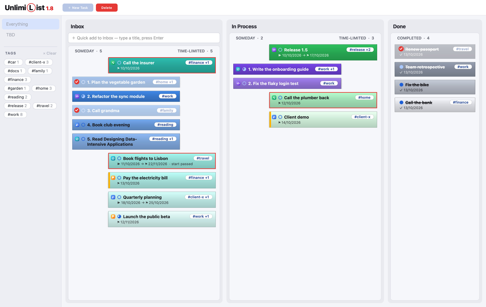
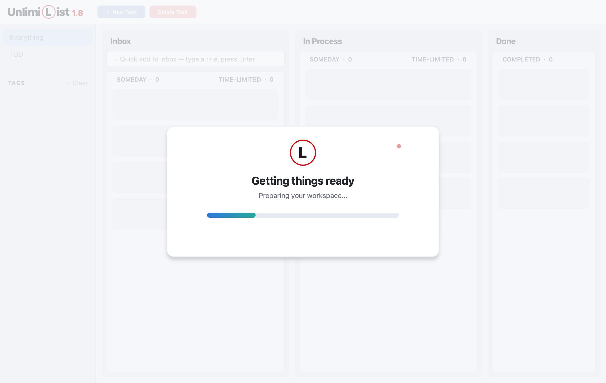

# UnlimiList - personal multi-lane task manager for macOS (Windows support on demand)


[](https://github.com/deltorro2/Unlimilist/releases/latest)


## Description
I have to participate in a large number of different activities, each of which generates multiple tasks. Some of these tasks have strict deadlines, while others do not.
At any given time, I work on several tasks in parallel, each at a different stage of completion. Every task has its own priority, which is constantly changing.
In addition, as I work on these tasks, I accumulate various pieces of context-specific information associated with each one, such as phone numbers, code snippets, links, and so on. I would like to store this information alongside the relevant task.
One important requirement is that the system must work regardless of internet connectivity (local-first).
None of the tools I’ve evaluated (Jira, Todoist, TickTick, Google Tasks, etc.) fully meet my requirements. At the same time, they come with an incredible number of features that are completely unnecessary for me. 
What I need is a very simple, Kanban-based task management system (Trello too simple) which presents a huge number of ToDo's and Tasks in the usable form and allows simple triage them by importance level. And that’s when I decided that if I wanted it done right, I’d have to build it myself…

## Screenshots

### Kanban Board


Each Stage shows its Someday Tasks on the left, ranked by Priority, and its Time-limited Tasks on the right, ordered by date. A red border marks a late Task (Overdue, or Start passed), and an amber stripe marks one that is Due soon. The badge at the start of a card shows its Activity, and the circle shows its progress: empty, two thirds when it has Subtasks, and full once Done. A card shows its Title, not its Details, so a long Title can wrap over all of the card's lines ([ADR 0003](docs/adr/0003-tiles-show-the-title-not-details.md)).

### Tags


Write a Tag anywhere in a Task's Details as `#word` (letters, digits, `-` and `_`; case doesn't matter). Tags exist only in the text, never as a separate field ([ADR 0002](docs/adr/0002-tags-live-in-details.md)).

- **On a card:** the first Tag sits at the end of the Title's first line, plus `+N` for the rest, in at most 12 characters (`#reading… +2`).
- **In the sidebar:** every Tag is listed A–Z with its count. Select one or more to show only Tasks with any of them; the Lane headers then read "2 of 5". **Clear** or **Everything** shows every Task again, and so does creating a Task. While filtered, cards can move to another Stage (landing at the bottom) but can't be reordered.
- **In the editor:** Tags are underlined, and typing `#` and a letter suggests existing Tags. Up/Down picks, Enter or Tab inserts, and Esc closes the list.

### Task Details


Click a card to edit it. Pick an Activity, add Subtasks as checkboxes in the Details, and keep links and snippets in Usable data. A Task can't enter Done while it has unfinished Subtasks.

### Deleting and duplicating


- **Delete Task** (the red toolbar button): click the Inbox and Done Tasks to delete, and they fade and show a red check; click one again to unselect it. Then press **Delete** and confirm. Esc cancels. In Process Tasks can't be deleted.
- **Right-click a Task:** Inbox Tasks offer **Duplicate Task** and **Delete Task**; Done Tasks offer **Delete Task**.
- A duplicate is titled `[Duplication] <title>`, with the same Details, Usable data, Activity and dates, and every Subtask unticked.
- Deleting never erases anything: the Task's file is renamed to end in `-deleted`, so the app no longer loads it, but you can recover it by renaming it back ([ADR 0004](docs/adr/0004-deleting-renames-the-task-file.md)).


### Startup


The window opens at once, faded, while your Tasks load in the background. The card stays for at least 5 seconds, then fades away to show the Board.

## Dev docs
A personal desktop Kanban for Tasks. The vocabulary is in [CONTEXT.md](CONTEXT.md), and design decisions are in [docs/adr](docs/adr).

The screenshots above are drawn from a made-up Board, never from your own Tasks. To redraw them after a UI change:

```sh
uv run python scripts/readme_screenshots.py   # writes the docs/*.png screenshots
```

## Building

### Prerequisites

- [uv](https://docs.astral.sh/uv/). It installs the pinned Python (3.13, see `.python-version`) and every dependency, so you don't need a separate Python install.
  ```sh
  brew install uv        # or: curl -LsSf https://astral.sh/uv/install.sh | sh
  ```
- macOS to build the `.app` bundle. On Windows or Linux the same script builds a plain executable folder instead.

### Steps

```sh
git clone https://github.com/deltorro2/Unlimilist.git
cd Unlimilist
uv sync                        # create .venv with Python 3.13 and all dependencies
uv run pytest                  # run the tests (Board domain + pytest-qt UI)
uv run python -m unlimilist    # run from source
./scripts/build_app.sh         # build the app with PyInstaller
```

`build_app.sh` writes `dist/Unlimilist.app` on macOS, using the icon `assets/Unlimilist.icns` and stamping the bundle with the app version. It then ad-hoc signs the bundle, so it runs on the Mac that built it.

### macOS installer (DMG)

```sh
./scripts/build_dmg.sh         # builds the app, then dist/Unlimilist-<version>.dmg
```

The DMG opens a window with Unlimilist next to an Applications shortcut. To install, drag the app onto Applications. To uninstall, drag it from Applications to the Trash; your Tasks stay in the data folder. The window layout is in `scripts/dmg_settings.py` and is written by [dmgbuild](https://dmgbuild.readthedocs.io), so building needs no Finder permissions.

The app is built for Apple Silicon (arm64) only. It isn't signed with an Apple Developer ID or notarized, so on the first launch macOS says it can't verify the developer. Right-click the app in Applications and choose **Open**, then **Open** again; after that it opens normally.

`build/`, `dist/` and the generated `*.spec` file are build output and are not committed.

## Data

Each Task is stored as one Markdown file in the app-data folder (`~/Library/Application Support/Unlimilist/tasks` on macOS). The files are read when the app starts.

### Test Tasks for manual testing

```sh
uv run python scripts/make_test_tasks.py            # add 26 made-up Tasks beside your own
uv run python scripts/make_test_tasks.py --remove   # delete them again
```

Quit the app first, since it reads the folder only when it starts. The test Tasks are files named `manual-test-NN.md`, so your own Tasks are never touched. Their dates are relative to today, so every Urgency shows: Overdue, Start passed and Due soon. They also cover every Activity, Subtasks that block Done, enough Tags for the sidebar to scroll, a long Tag cut in the chip, long Titles, `#` signs that aren't Tags, and a file with an unknown Activity, which the app reports in the status bar. Each Task's Details say what it checks.

## Version and icon

The version lives in `src/unlimilist/__init__.py` and is shown next to the app name. The app icon is `assets/Unlimilist.icns` for the bundle and `src/unlimilist/assets/app_icon.png` for the window.
