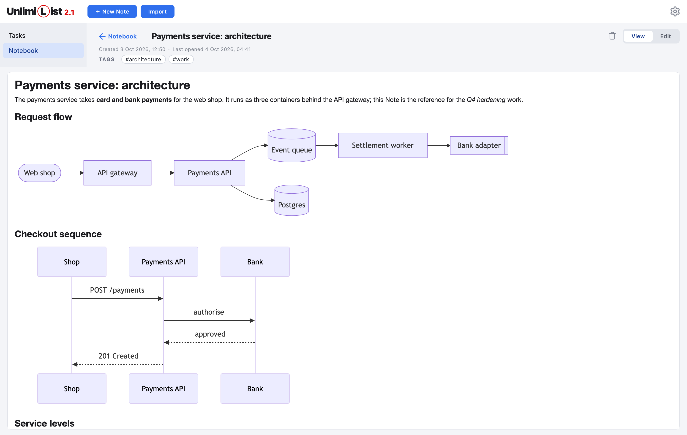
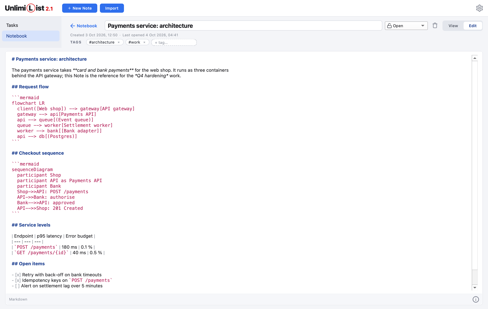
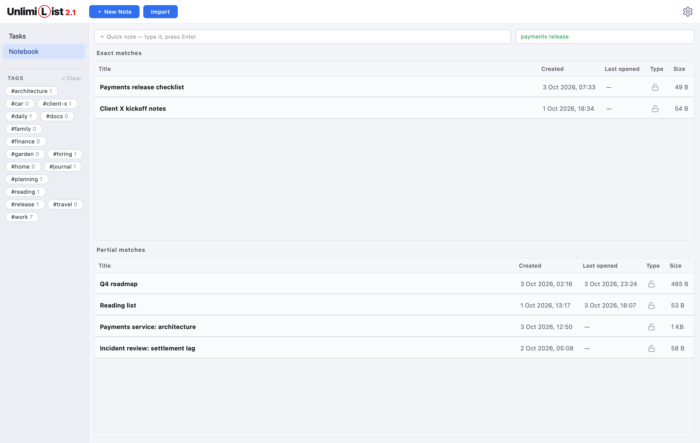
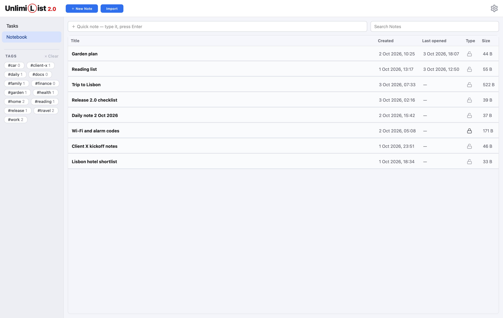

<p align="center">
  
</p>

<h1 align="center">UnlimiList</h1>

<p align="center">
  <b>Task management and Markdown notes for professionals, in one local-first macOS app.</b><br>
  A prioritising Kanban board for your work, and an encrypted, Mermaid-capable notebook for everything you know.
</p>

<p align="center">
  <a href="https://github.com/deltorro2/Unlimilist/releases/latest"></a>
  
  
  
  
</p>


## Overview

UnlimiList is built for people who run several streams of work at once: client projects, engineering, operations and their own commitments. It combines two tools that usually live apart:

- **Tasks**: a Kanban board that keeps open-ended work and dated work side by side, and decides on its own what deserves attention next.
- **Notes**: a Markdown notebook with live rendering, embedded Mermaid diagrams, full-text search and per-note encryption.

Everything is stored as plain Markdown files on your Mac. There is no account, no cloud service and no network dependency. Your data stays readable, portable and under your control.

## Tasks

### Smart prioritisation

The Board doesn't just list Tasks. It orders them.

- **Two kinds of work in one column.** *Someday* Tasks (no dates) are ranked by your Priority. *Time-limited* Tasks (a start date, a deadline or both) are ordered by date. Both appear in a single, interleaved column.
- **An order that thinks ahead.**
  - The most urgent dated Task leads, followed by your top Someday Tasks.
  - Later deadlines settle among the Someday work, one step further down for each month away.
  - Today's work is never crowded out by commitments that are weeks away.
- **Urgency at a glance.** Overdue Tasks and Tasks whose start date has passed are outlined in red. Tasks due today or tomorrow carry an amber marker.
- **Stages that mean something.** Inbox, In Process and Done. A Task with unfinished Subtasks can't be completed, and work in progress can't be deleted by accident.

### Everything a Task needs, inside the Task

<p align="center">
  
</p>

- **Details** in rich text, with **Subtasks** as checklists.
- **Usable data**: links, numbers and code snippets, kept with the Task.
- **Activities**: General Task, Ask, Phone call, Meeting, Develop or Milestone, shown as a badge on each card.
- **Tags** written inline as `#client-x`, with autocomplete. The sidebar filters the Board to one client, project or theme in a click.


### Built for daily use

- Drag and drop between Stages and Lanes. A Task that moves is briefly highlighted where it lands.
- Quick add to the Inbox from a single line.
- Multi-select delete, and duplicate a Task to reuse it. Deleted files are kept, so they can always be recovered.
- Fold Done to a slim strip, so the active work gets the room.
- Five card font sizes in Settings.

## Notes

### Markdown, written and read properly



- **Edit mode** is a raw Markdown editor with syntax colouring for headings, emphasis, code, links, lists, quotes and tables, plus a built-in cheat sheet.
- **View mode** renders GitHub-flavoured Markdown: tables, task lists, strikethrough, code blocks and links. Links open in your browser.
- **Mermaid diagrams are embedded.** A fenced ` ```mermaid ` block renders as a diagram in View mode: flowcharts, sequence, class, state and ER diagrams, Gantt charts, pie charts and mind maps.
  - The diagram engine ships with the app, so rendering works fully offline.
  - A malformed diagram shows its source next to a clear error.
- **Edits save themselves**: when you leave Edit mode, when you leave the Note, and every five minutes.



### Find anything



- **Search across all Notes** (⌘F), in titles and full text. Matches are highlighted as you type.
- **Exact and partial matches** are listed separately: Notes containing the whole phrase come first, then Notes containing some of its words, ranked by relevance.
- **Find in Note** (⌘F in an open Note) steps through every occurrence.
- A search index keeps lookups instant on large notebooks.

### Encryption where it matters

- **Secured Notes** encrypt their content with **AES-256-GCM**. The key is derived from your Notebook password with **scrypt**, with a fresh salt and nonce on every save.
- The Notebook password is **stored in the macOS Keychain** (under "Unlimilist"), protected by your Mac login, and never written to the app's own files. Every password you type is checked against that Keychain entry. It's asked for once per session, and if you forget it, you can look it up in the Keychain Access app.
- Titles and Tags stay readable, so encrypted Notes still sort, filter and appear in search by title.
- The password can be changed at any time; every Secured Note is re-encrypted in one step.

### Bring your documents in



- **Import** Markdown, plain text, CSV (as a table), Word (.docx) and PDF files. Each becomes Markdown, either as a new Note or inserted into the Note you're editing.
- **Quick note** captures a thought in one line. A Note with text but no title becomes a dated *Daily note*.
- **Tags are shared with Tasks**, so one Tag in the sidebar brings up the related Tasks and Notes together.

## Your data

- **Plain files.** Every Task and every Note is one Markdown file with a small YAML header, readable in any editor and easy to back up, sync or version.
- **Local only.** No account, no telemetry, no internet connection required.
- **Recoverable.** Deleted Tasks and Notes are renamed, not erased. The only exception is Secured Notes, which are removed for good.

| Location | Contents |
|---|---|
| `~/Library/Application Support/Unlimilist/tasks` | Tasks |
| `~/Library/Application Support/Unlimilist/notes` | Notes and the search index |
| `~/Library/Application Support/Unlimilist/settings.json` | Settings |
| macOS Keychain, item "Unlimilist" | The Notebook password for Secured Notes |

## Keyboard shortcuts

| Shortcut | Action |
|---|---|
| ⌘N | New Task (Board) or New Note (Notebook) |
| ⌘F | Search Notes, or Find in the open Note |
| Esc | Close the open Note and return to the list |
| ⌘, | Settings |

## Install

1. Download **Unlimilist-&lt;version&gt;.dmg** from the [latest release](https://github.com/deltorro2/Unlimilist/releases/latest).
2. Open it and drag **UnlimiList** onto **Applications**.
3. On first launch, right-click the app and choose **Open**: the app isn't notarized by Apple yet.

**Requirements:** macOS on Apple Silicon. Windows support is available on request.

---

# For developers

UnlimiList is a Python 3.13 desktop app built with [PySide6](https://doc.qt.io/qtforpython-6/) (Qt 6). Tasks and Notes are stored as Markdown files with YAML front matter.

| | |
|---|---|
| Runtime | Python 3.13, PySide6 (Qt 6) with Qt WebEngine, PyYAML, markdown-it-py, cryptography, keyring, mammoth, pypdf |
| Bundled | mermaid.js 11.4.1 (MIT), in `src/unlimilist/assets/mermaid` |
| Tests | pytest, pytest-qt, python-docx |
| Packaging | PyInstaller (`.app`), dmgbuild (`.dmg`) |
| Environment | [uv](https://docs.astral.sh/uv/) |

## Set up

You only need [uv](https://docs.astral.sh/uv/) and Git. uv installs the pinned Python (see `.python-version`) and every dependency into a local `.venv`, so no separate Python install is needed.

```sh
brew install uv                      # or: curl -LsSf https://astral.sh/uv/install.sh | sh
git clone https://github.com/deltorro2/Unlimilist.git
cd Unlimilist
uv sync                              # Python 3.13 + runtime and dev dependencies into .venv
```

## Run and test

```sh
uv run python -m unlimilist          # run from source: uses the test folders, never your real Tasks and Notes
uv run pytest                        # all tests: the Board domain plus pytest-qt UI tests
```

The UI tests run on Qt's offscreen platform, so no windows open. Pass `QT_QPA_PLATFORM=cocoa` to run them against real macOS rendering.

## Project layout

```text
src/unlimilist/
  domain.py        Task, Stage, Activity, Tags, Subtasks: plain data and rules
  board.py         the Board: every rule for where a Task sits; no Qt
  store.py         one Markdown file per Task (load, save, delete)
  notebook.py      the Notebook: Notes, Titles, Daily notes, Tags, Secured Notes; no Qt
  note_store.py    one Markdown file per Note
  note_import.py   Markdown, text, CSV, Word and PDF files to Markdown
  note_html.py     a Note's Markdown as the HTML page View mode shows; Mermaid blocks left for mermaid.js
  note_search.py   the Notebook search: Exact and Partial matches, and its index file
  secure.py        encrypting a Secured Note's Body (AES-GCM, scrypt)
  notebook_password.py  the Notebook password, checked against the Keychain
  settings.py      settings.json: the user's settings, such as the card font size
  app.py           startup, styles, the data folder
  data_folders.py  which folders a run reads: tasks and notes (normal build), or test and test-notes
  ui/              the Qt widgets: main window, Columns, cards, Task dialog, Notebook, Show Note, Settings,
                   sidebar, password dialogs, loading card
tests/             test_board.py (domain), test_notebook.py, test_note_import.py, test_secured_notes.py,
                   test_note_search.py, test_ui.py, test_notebook_ui.py, test_note_search_ui.py, test_settings.py, test_highlight.py, test_fold_done.py,
                   test_loading.py, test_delete_and_duplicate.py, test_data_folders.py
scripts/           build_app.sh, build_dmg.sh, make_test_tasks.py, make_test_notes.py, readme_screenshots.py
docs/adr/          architecture decision records
CONTEXT.md         the glossary: the words the code and the UI use
```

## Build

```sh
./scripts/build_app.sh               # dist/Unlimilist.app: the normal build, reads your real Tasks and Notes
./scripts/build_dmg.sh               # the normal app, then dist/Unlimilist-<version>.dmg
./scripts/build_app.sh --test        # dist/Unlimilist Test.app: for manual testing, reads the test folders
```

- **Normal or test:** only a packaged normal build reads your real Tasks and Notes.
  - The test build reads the `test` and `test-notes` folders and shows an orange **TEST** tag after the version.
  - It has its own bundle id (`com.unlimilist.app.test`), so it can sit beside the real app and run at the same time.
  - Each test build refreshes the test Tasks and Notes in its folders.
  - It shares your settings and your Notebook password (the Keychain entry) with the real app.
  - It never gets a DMG and is never released. Running from source behaves like the test build.

- **App:** `build_app.sh` stamps the bundle with the app version and ad-hoc signs it, so it runs on the Mac that built it. On Windows or Linux it builds a plain executable folder instead.
- **DMG:** shows the app beside an Applications shortcut. The layout is in `scripts/dmg_settings.py` and is written by dmgbuild, so building needs no Finder permissions.
- **Signing:** builds are Apple Silicon (arm64) only, and not signed with an Apple Developer ID or notarized.
- **Output:** `build/`, `dist/` and the generated `*.spec` file are not committed.

## Data

Each Task is one Markdown file in the app-data folder: in `tasks` for the normal build, and in `test` for the test build and runs from source. Notes work the same way, in `notes` and `test-notes`.

| OS | App-data folder |
|---|---|
| macOS | `~/Library/Application Support/Unlimilist/` |
| Windows | `%APPDATA%\Unlimilist\` |
| Linux | `~/.local/share/Unlimilist/` |

```markdown
---
id: 2026-10-12-c4146d
stage: inbox
activity: phone-call
priority: 1
due_date: null
deadline: 2026-10-20
created_at: 2026-10-12 09:00:00
completed_at: null
---
# Call the insurer

## Details

Send the receipts #finance

## Usable data

+1 555 0100
```

A Note keeps its Title, Type and Tags in the front matter; the Body follows. A Secured Note's Body is an encrypted block (see [ADR 0005](docs/adr/0005-secured-notes-encrypt-the-body-with-one-keychain-password.md)).

```markdown
---
id: 2026-10-21-a1b2c3
title: Trip to Lisbon
type: open
tags:
- travel
created_at: 2026-10-21 14:05:00
opened_at: 2026-10-21 14:30:00
---
# Day 1

Alfama and tram 28
```

- The folders are read once, when the app starts. Hand edits are welcome while the app is closed; a broken file is skipped with a warning in the status bar.
- A deleted Task's or Open Note's file is renamed to end in `-deleted` and never loaded again. Rename it back to restore it. A deleted Secured Note's file is removed for good.
- The Notebook search keeps a word index of the Open Notes in `.search-index.json` in the notes folder. It is rebuilt if it's missing or out of date, so it's safe to delete. Secured Notes are never in it.
- The Notebook password is kept only in your Keychain, under "Unlimilist". Without it, Secured Notes can't be read.
- Your settings, such as the card font size, are kept in `settings.json` next to the `tasks` folder, shared by both builds. Delete it to go back to the defaults.
- To back up, copy the `Unlimilist` folder.

**Test data.** The test folder holds 26 made-up Tasks that exercise every feature; `build_app.sh --test` refreshes them. To refresh them by hand, quit the test app and run:

```sh
uv run python scripts/make_test_tasks.py            # add or refresh the test Tasks (manual-test-NN.md) in test/
uv run python scripts/make_test_tasks.py --remove   # remove them again
```

The `test-notes` folder gets 12 made-up Open Notes the same way (`scripts/make_test_notes.py`), one of them a long Note with ten Mermaid diagrams (one broken on purpose). They are all Open, because a Secured Note needs your Notebook password: make those in the test app.

Other Tasks and Notes you create while testing stay in the test folders until you delete them.

## Docs

- [CONTEXT.md](CONTEXT.md) is the glossary: Task, Stage, Lane, Someday, Time-limited, Tag, Subtask and more. Use these words in code and UI.
- [docs/adr](docs/adr) records the decisions that would surprise a newcomer, e.g. why Tags live in the Details text.
- The screenshots are drawn from a made-up Board and Notebook, never from real Tasks or Notes. Redraw them after a UI change with `uv run python scripts/readme_screenshots.py`.

## Workflow and releases

- **Branches:** features, and the fixes that belong to them, go on `dev`. A pull request brings a finished feature to `main`.
- **Version:** it lives in `src/unlimilist/__init__.py` and is shown next to the app name.
- **Releases:** they are tagged on `main` (`v2.0.0`), and the DMG is attached to the GitHub release.
- **Icons:** the app icon is `assets/Unlimilist.icns` for the bundle and `src/unlimilist/assets/app_icon.png` for the window.
